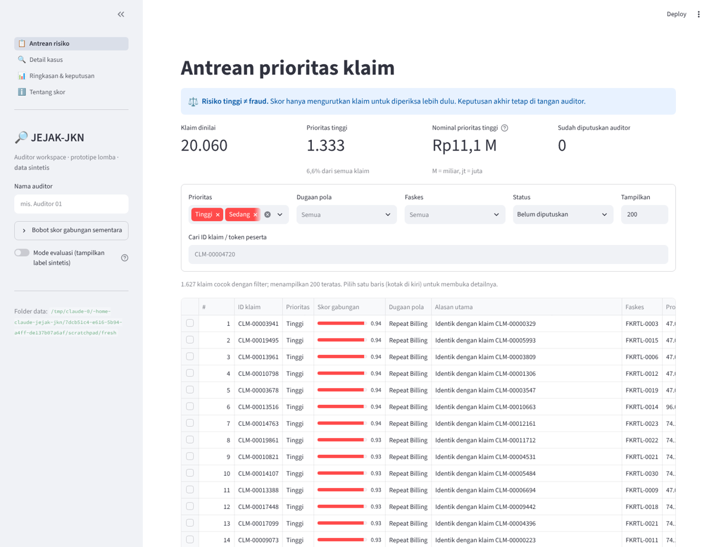
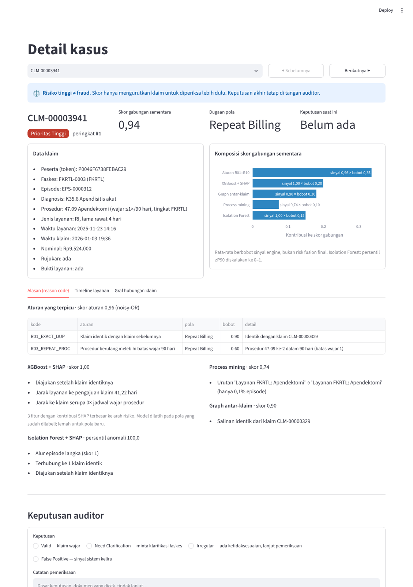
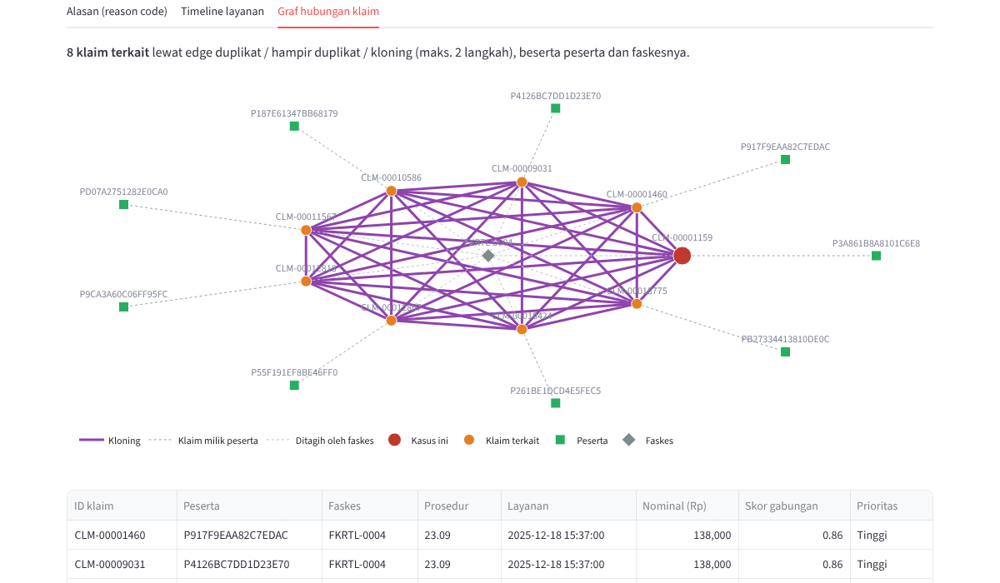

# jejak-jkn

**JEJAK-JKN: Process-Aware Graph Intelligence for Smarter JKN Protection** — entri BPJS Healthkathon 2026.

Membantu auditor JKN memprioritaskan klaim berisiko (Phantom Billing, Repeat Billing, Cloning)
dengan risk score dan alasan yang bisa dijelaskan. Semua data di repo ini **sintetis**.

Untuk asisten AI: mulai dari [`AGENTS.md`](AGENTS.md) dan [`docs/memory/`](docs/memory/).

## Menjalankan

```bash
python3 -m venv .venv
.venv/bin/pip install -e ".[dev]"
.venv/bin/python -m jejak pipeline --n 20000 --seed 42 --out data   # generate → validate → rules → evaluate
.venv/bin/python -m pytest

.venv/bin/python -m jejak ml --data data   # process mining + graph + Isolation Forest + XGBoost/SHAP vs aturan
```

**Demo dashboard auditor (satu perintah):**

```bash
.venv/bin/pip install -e ".[app]"
.venv/bin/python -m jejak demo            # buat data + skor bila belum ada (±30 detik), lalu buka http://localhost:8501
.venv/bin/python -m jejak demo --rebuild  # buat ulang data dan skor
```

Perintah terpisah: `generate`, `validate`, `rules`, `evaluate`, `ml`, `demo` (lihat `python -m jejak -h`).
Hasil di `data/` (tidak di-commit): `claims.csv`, `labels.csv`, `facilities.csv`, `participants.csv`,
`rule_hits.csv` (satu baris per alasan), `rule_scores.csv` (satu baris per klaim, terurut skor).

**Mac Intel (tanpa Homebrew):** XGBoost butuh `libomp.dylib`. Homebrew tidak lagi mendukung Mac Intel,
dan libomp bawaan scikit-learn terlalu lama untuk XGBoost 3.x. Ambil `llvm-openmp` osx-64 dari conda-forge
(mis. `llvm-openmp-23.1.3-h8c1e6b9_0.conda`, md5 `85edbb56b37fc44b823f32d126214059`), ekstrak `lib/libomp.dylib`
ke `.venv/lib/`, lalu arahkan XGBoost ke sana:

```bash
X=.venv/lib/python3.*/site-packages/xgboost/lib/libxgboost.dylib
install_name_tool -add_rpath @loader_path/../../../.. $X && codesign --force -s - $X
```

Langkah `install_name_tool` perlu diulang setiap kali XGBoost dipasang ulang.

## Data sintetis (`src/jejak/generator.py`)

Klaim normal dibentuk dari episode layanan: kunjungan tunggal FKTP, kontrol kronis, seri fisioterapi
dan hemodialisis, serta konsultasi FKTP lalu rujukan ke FKRTL. Derau realistis ditambahkan
(±1,5% klaim sah tanpa bukti, ±1% FKRTL tanpa rujukan) supaya aturan tidak sempurna.

| Kolom | Isi |
|---|---|
| `claim_id`, `episode_id` | ID klaim dan episode layanan |
| `participant_token` | token pseudonim peserta (bukan NIK/no. kartu) |
| `facility_id`, `facility_type` | faskes `FKTP-xxxx` / `FKRTL-xxxx` |
| `diagnosis_code`, `procedure_code` | ICD-10 dan ICD-9-CM dari katalog kecil (`catalog.py`) |
| `service_type`, `los_days`, `referral_flag` | RJ/RI, lama rawat, ada rujukan |
| `service_timestamp`, `claim_timestamp` | waktu layanan dan waktu pengajuan klaim |
| `claim_amount`, `evidence_flag` | nominal (rupiah) dan kelengkapan bukti layanan |

Skenario yang disuntikkan (label di `labels.csv`, terpisah dari klaim):

| Skenario | Jenis | Cara dibuat |
|---|---|---|
| `exact_duplicate` | repeat | salinan persis klaim lain, diajukan belakangan |
| `near_duplicate` | repeat | salinan dengan geser 1–2 hari dan nominal ±3% |
| `repeated_procedure` | repeat | prosedur jarang (apendektomi, katarak, dll.) ditagih melebihi batas wajar 90 hari |
| `missing_evidence` | phantom | klaim FKRTL tanpa bukti dengan nominal digelembungkan |
| `process_deviation` | phantom | klaim sebelum layanan, FKRTL tanpa rujukan, atau prosedur FKRTL ditagih FKTP |
| `cloning` | cloning | satu template klaim dipakai 6–12 peserta di faskes dan hari yang sama |

## Validasi (`schema.py`)

Pandera memeriksa struktur dan domain nilai saja. Klaim yang janggal secara bisnis tetap lolos
supaya bisa dinilai oleh rule engine.

## Rule engine (`rules.py`)

| Kode | Jenis | Bobot | Aturan |
|---|---|---|---|
| R01_EXACT_DUP | repeat | 0.90 | identik dengan klaim yang diajukan lebih dulu |
| R02_NEAR_DUP | repeat | 0.70 | peserta, faskes, prosedur sama; ≤3 hari (lebih rapat untuk prosedur rutin); nominal ±5% |
| R03_REPEAT_PROC | repeat | 0.60 | frekuensi prosedur per peserta melewati batas 90 hari |
| R04_NO_EVIDENCE | phantom | 0.40 | bukti layanan tidak ada |
| R05_NO_EVIDENCE_HIGH_AMT | phantom | 0.40 | tanpa bukti dan nominal di atas P90 prosedur |
| R06_CLAIM_BEFORE_SERVICE | phantom | 0.85 | klaim diajukan sebelum layanan |
| R07_NO_REFERRAL | phantom | 0.50 | FKRTL tanpa rujukan |
| R08_LEVEL_MISMATCH | phantom | 0.70 | prosedur tingkat FKRTL ditagih FKTP |
| R09_CLONE_TEMPLATE | cloning | 0.75 | ≥5 peserta berbeda, faskes/hari/diagnosis/prosedur/nominal identik |
| R10_AMOUNT_OUTLIER | phantom | 0.25 | nominal > Q3 + 3·IQR prosedur |

`rule_score = 1 − Π(1 − bobot)` (noisy-OR). Setiap klaim membawa `reason_codes` dan `top_reason`
berbahasa Indonesia, mis. *"Prosedur 47.09 ke-3 dalam 90 hari (batas wajar 1)"*.

**Catatan jujur:** aturan dan skenario dirancang oleh tim yang sama, jadi skor pada data sintetis
(PR-AUC ±0,94 pada 20k klaim, seed 42) adalah batas atas, bukan perkiraan kinerja di data nyata.

## Engine lanjutan (`python -m jejak ml`)

Semua engine hanya membaca klaim (tanpa label). Label dipakai untuk melatih XGBoost dan menghitung metrik.

| Modul | Engine | Keluaran per klaim |
|---|---|---|
| `process.py` | **Process mining (PM4Py).** Event log per episode: `Rujukan FKTP` → `Layanan <tingkat>: <prosedur>` → `Klaim diajukan`. Sinyal: kelangkaan transisi (directly-follows) + fitness token replay terhadap model Inductive Miner | `proc_score`, `proc_reason` (mis. *"Episode diawali 'Klaim diajukan' (hanya 1,0% episode)"*) |
| `graph.py` | **Graph antar-klaim (NetworkX).** Edge `duplikat`, `hampir_duplikat`, `kloning` lewat blocking; fitur komponen, klaster kloning, pola peserta–faskes | `graph_score`, `graph_reason`, `graph_edges.csv` |
| `features.py` | 20 fitur klaim/pengulangan/proses/graf + templat alasan Bahasa Indonesia | `features.csv` |
| `models.py` | **Isolation Forest** (tanpa label) dan **XGBoost** (dilatih di dataset sintetis seed lain), dijelaskan dengan **SHAP** | `anomaly_score`, `anomaly_reason`, `ml_score`, `ml_reason` |
| `experiment.py` | Evaluasi semua engine vs aturan, leave-one-scenario-out, ablasi | `ml_report.md` |

Keluaran di `data/`: `risk_scores.csv` (skor + alasan semua engine), `graph_edges.csv`, `features.csv`,
`model_xgb.json`, `ml_report.md`. Durasi ±25 detik untuk 20k klaim uji + 20k klaim latih.

### Hasil (20k klaim uji seed 42, XGBoost dilatih 20k klaim seed 1042)

| Engine | Precision | Recall | F1 | PR-AUC | P@500 | P@1000 |
|---|---|---|---|---|---|---|
| Aturan R01–R10 (baseline) | 0,938 | 0,925 | 0,931 | 0,936 | 1,000 | 0,991 |
| Process mining | 0,729 | 0,233 | 0,353 | 0,444 | 0,730 | 0,629 |
| Graph antar-klaim | 0,983 | 0,474 | 0,640 | 0,517 | 1,000 | 0,766 |
| Isolation Forest (5% teratas) | 0,919 | 0,576 | 0,708 | 0,877 | 0,946 | 0,921 |
| XGBoost | 0,979 | 0,988 | 0,984 | 0,998 | 1,000 | 0,999 |

**Cara membaca angka ini dengan jujur:**
- XGBoost 0,998 **sirkular**: skenario latih dan uji berasal dari generator yang sama. Saat satu skenario
  dihapus dari data latih (*leave-one-scenario-out*), recall XGBoost pada skenario itu turun ke 0,03–0,37
  (PR-AUC 0,20–0,62). Jadi XGBoost hanya andal untuk pola fraud yang **sudah pernah dilabeli auditor**.
- Isolation Forest tidak memakai label sama sekali; PR-AUC 0,88 adalah sinyal paling jujur untuk pola baru,
  tetapi tetap terbantu karena skenario sintetis cukup mencolok.
- Process mining dan graph adalah engine **spesifik**: process mining kuat untuk penyimpangan proses
  (recall 0,69), graph untuk duplikat dan kloning (recall 1,00), dan sengaja tidak menilai pola lain.
- Generator membuat klaim suntikan sebagai episode baru berisi satu klaim. Fitur yang memanfaatkan artefak ini
  (`episode_n_claims`, `pf_visits`, `participant_n_facilities`) dikeluarkan dari model default; hasil dengan
  fitur itu dilaporkan sebagai ablasi di `ml_report.md`.
- PR-AUC dihitung dengan ties sebagai satu ambang, sehingga baseline aturan kini 0,936 (sebelumnya 0,946
  bergantung pada urutan baris).
- PM4Py berlisensi AGPL v3.

## Auditor workspace (`python -m jejak demo`)

Dashboard Streamlit (`app.py`, logika di `workspace.py`) berbahasa Indonesia. Prinsip: **risiko tinggi ≠ fraud**;
skor hanya mengurutkan klaim, keputusan akhir di tangan auditor.

| Halaman | Isi |
|---|---|
| Antrean risiko | klaim urut skor gabungan (lalu nominal), prioritas Tinggi/Sedang/Rendah, dugaan pola, alasan utama; filter prioritas, pola, faskes, status keputusan, cari ID |
| Detail kasus | data klaim, komposisi skor (sinyal × bobot per engine), reason code aturan + alasan SHAP XGBoost/Isolation Forest + process mining + graph, timeline riwayat peserta dan alur episode, graf hubungan klaim–peserta–faskes, form keputusan |
| Ringkasan & keputusan | sebaran prioritas × pola, faskes teratas, log keputusan + unduh CSV |
| Tentang skor | cara membaca skor dan bobot |

**Skor gabungan sementara** (risk fusion belum dibangun): `Σ(bobot × sinyal) / Σ bobot` dengan bobot bawaan
aturan 0,35 · XGBoost 0,20 · graph 0,20 · process 0,10 · Isolation Forest 0,15. Sinyal Isolation Forest = persentil
≥P90 diskalakan ke 0–1. Prioritas Tinggi ≥ 0,50, Sedang ≥ 0,25. Bobot bisa diubah di sidebar. Pada 20k klaim seed 42,
PR-AUC skor ini 0,987 dan P@1000 0,99 — tetap optimistis karena memuat XGBoost yang sirkular (lihat di atas).

**Keputusan auditor** (*Valid / Need Clarification / Irregular / False Positive*) + catatan disimpan lokal ke
`data/keputusan_auditor.csv` (log append-only; keputusan terbaru per klaim yang berlaku). Label sintetis
disembunyikan; toggle **Mode evaluasi** di sidebar menampilkannya untuk juri/tim saja. Tautan langsung ke kasus:
`http://localhost:8501/kasus?klaim=CLM-00001159`.

| Antrean | Detail kasus | Graf kloning |
|---|---|---|
|  |  |  |
